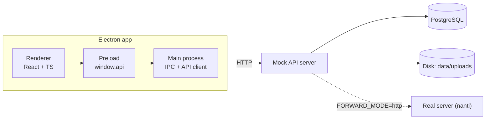
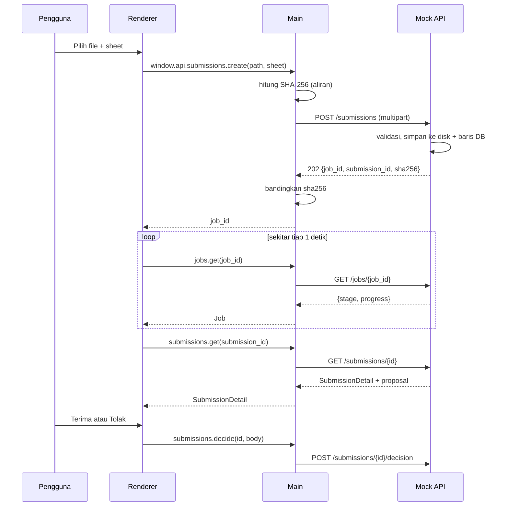

# Schema Matcher Desktop: Rekap Alur Kerja dan Rencana Implementasi

Dokumen ini merangkum seluruh rancangan MVP aplikasi desktop (Electron + React + TypeScript) beserta server tiruan (mock API), rencana belajar, dan rencana pengerjaan 10 hari.

---

## 1. Ringkasan

| Item | Isi |
|---|---|
| Tujuan | Aplikasi desktop untuk mengunggah file Excel, memantau analisis, dan mereview proposal hasil pencocokan skema |
| Cakupan MVP | Layar 1–5: Unggah, Progres, Review proposal, Pengaturan, Daftar submission |
| Di luar MVP | Antrean `needs_review`, penjelajah katalog, riwayat entri, ekspor laporan, batch/zip |
| Penonton demo | Tim data |
| Waktu | 10 hari (hari ke-10 adalah cadangan) |
| Stack | Electron + React + TypeScript (klien); Python + FastAPI + Pydantic + PostgreSQL (mock API) |
| Prinsip utama | Satu kontrak OpenAPI; klien tidak tahu apakah di seberang ada mock atau server asli |

Lima verdict: `new_dataset`, `new_source`, `enrichment`, `duplicate`, `needs_review`.
Status submission: `processing`, `draft`, `accepted`, `merged` (status `rejected` belum ada, menunggu keputusan backend).

---

## 2. Arsitektur



### Lapisan di dalam Electron

| Lapisan | Tanggung jawab |
|---|---|
| Renderer (React) | Halaman, state tampilan, TanStack Query untuk cache, polling, dan error. Tidak punya akses Node dan tidak tahu URL server |
| Preload | `window.api` bertipe lewat `contextBridge`. Hanya fungsi bernama, tidak pernah `ipcRenderer` mentah |
| Main (Node) | Handler IPC, validasi input, dialog file, penyimpanan pengaturan, klien API hasil generate dari OpenAPI, pembacaan Excel untuk pratinjau (SheetJS) |

### Keputusan arsitektur

1. **Thin client.** Semua logika pencocokan ada di server. Aplikasi desktop hanyalah konsol untuk mengunggah, memantau, dan mereview.
2. **Hanya main yang bicara dengan server.** Token dan URL server tidak terlihat oleh halaman. CORS tidak relevan karena main adalah Node.
3. **Pratinjau dan nama sheet dibaca di main** (SheetJS), bukan di server. Server tiruan tidak memproses isi file, dan pratinjau dari server akan palsu.
4. **Job berbasis polling.** `POST` mengembalikan `202` + `job_id`, lalu klien memanggil `GET /jobs/{id}` sekitar satu detik sekali sampai `done`.
5. **Store-and-forward.** Server menyimpan file mentah lebih dulu, baru meneruskannya lewat `Forwarder`. File tidak hilang jika server asli sedang mati.
6. **Kontrak tidak bergantung pada metode matching.** UI hanya membaca `Proposal {verdict, similarity, reason, incoming, matched}`. Kalau engine berubah (mis. dari nearest-vector ke clustering), UI tidak perlu ditulis ulang.

### Aturan keamanan dan kualitas Electron

- `contextIsolation: true`, `nodeIntegration: false`, `sandbox: true`.
- Preload hanya mengekspos fungsi spesifik.
- Input dari renderer divalidasi di handler IPC (main).
- Satu bentuk error seragam dari server: `{ "code": "...", "message": "..." }`, dan satu tempat di renderer yang menampilkannya.
- Data tampilan selalu lewat hooks, bukan `fetch` di dalam komponen halaman.
- Untuk IPC, ikuti dokumentasi resmi Electron (Process Model, Context Isolation, IPC), bukan pola lama dari buku 2018 (`remote`, `nodeIntegration`).

---

## 3. Struktur repo

```
schema-matcher/
├─ api-mock/                 # server tiruan (Python, FastAPI + Pydantic)
│  ├─ app/
│  │  ├─ main.py             # aplikasi + route
│  │  ├─ models.py           # model Pydantic = kontrak
│  │  ├─ scenarios.py        # nama file → verdict dummy
│  │  ├─ jobs.py             # job palsu berbasis waktu
│  │  ├─ storage.py          # simpan file + hitung SHA-256
│  │  ├─ forwarder.py        # MockForwarder / HttpForwarder
│  │  └─ db.py               # akses PostgreSQL (psycopg 3)
│  ├─ data/uploads/          # file mentah (di-.gitignore)
│  └─ openapi.json           # hasil ekspor kontrak
├─ desktop/                  # electron-vite (react-ts)
│  └─ src/
│     ├─ main/               # index.ts, ipc/, api-client.ts, store.ts
│     ├─ preload/index.ts
│     ├─ renderer/           # pages/, hooks/, components/
│     └─ shared/             # api-types.ts (generate), ipc-contract.ts
└─ scripts/gen-api.sh        # openapi.json → api-types.ts
```

Dua file di `shared/` menjaga tipe tetap tunggal: `api-types.ts` dihasilkan dari OpenAPI (`openapi-typescript`), dan `ipc-contract.ts` mendefinisikan daftar fungsi `window.api` sekali untuk preload, main, dan renderer.

---

## 4. Kontrak API

### Endpoint MVP

| Method + path | Fungsi | Sukses | Error | Layar |
|---|---|---|---|---|
| `GET /health` | cek server hidup | 200 `{status, version}` | - | Pengaturan |
| `POST /submissions` | unggah file mentah | **202** + `Location` | 400, 413, 415, 422 | Unggah |
| `GET /jobs/{job_id}` | tahap dan persen | 200 `Job` | 404 | Progres |
| `GET /submissions` | daftar (filter, halaman) | 200 `{items,total,page,page_size}` | 422 | Daftar |
| `GET /submissions/{id}` | detail + proposal | 200 `SubmissionDetail` | 404 | Review |
| `POST /submissions/{id}/decision` | terima atau tolak | 200 `Submission` | 404, 409, 422 | Review |
| `GET /submissions/{id}/file` | unduh file mentah | 200 biner | 404 | alat verifikasi |
| `POST /dev/reset` | kosongkan data | 204 | - | persiapan demo |

Catatan:
- `/dev/reset` dipasang dengan `include_in_schema=False`, jadi tidak masuk kontrak dan tidak ikut ke server asli.
- `GET /submissions` mendukung `status`, `verdict`, `q`, `page`, `page_size` (maksimal 100), urut `uploaded_at` menurun.
- `GET /submissions/{id}` mengembalikan `proposal: null` selama masih `processing`.

### Aturan `decision`

Body: `{"action": "accept" | "reject", "verdict": Verdict | null, "target_entry_id": str | null, "note": str | null}`.

- `accept` pada proposal `needs_review` tanpa `verdict` manual → **409** (orang harus memutuskan dulu).
- `accept` pada submission yang sudah `merged` → **409**.
- `reject`: belum punya status tujuan di enum. Di mock cukup mencatat `note` dan membiarkan status `draft`. Beri komentar di kode bahwa ini belum final.

### Format error

| Status | `code` | Penyebab |
|---|---|---|
| 400 | `bad_request` | body bukan multipart |
| 404 | `not_found` | resource tidak ada |
| 409 | `conflict` | bentrok dengan keadaan saat ini |
| 413 | `file_too_large` | melebihi batas (mis. 50 MB) |
| 415 | `unsupported_type` | ekstensi atau magic bytes tidak cocok |
| 422 | `validation_error` | field tidak valid atau hilang |

---

## 5. Transport file Excel lewat HTTP (tanpa mengubah satu byte pun)

### Prinsip

Bayangkan file Excel sebagai **barang di dalam kardus tersegel**. HTTP hanyalah kurir. Kurir yang baik tidak membuka kardus. Artinya, di setiap titik file diperlakukan sebagai **byte**, tidak pernah sebagai teks, JSON, atau objek yang dibuka dan disimpan ulang.

Isi file:
- `.xlsx` adalah arsip zip berisi XML (`[Content_Types].xml`, `xl/workbook.xml`, ...). Diawali `PK\x03\x04`.
- `.xls` adalah format biner lama (OLE2). Diawali `D0 CF 11 E0 A1 B1 1A E1`.

HTTP tidak peduli isinya: ia hanya membawa byte dan satu label (`Content-Type`) yang memberi tahu penerima cara membacanya.

### Dua hal yang sering dicampur

| Skenario | Yang terjadi | Tingkat kesulitan |
|---|---|---|
| **A. Pulang-pergi identik** (unggah lalu unduh file asli) | byte yang diunduh **sama persis** dengan yang diunggah | mudah, aturan di bawah |
| **B. File turunan** (mis. laporan ekspor) | workbook **baru** dibuat oleh server atau klien | beda hal, bukan pulang-pergi |

Untuk B, jangan membuka file asli lalu menyimpannya ulang dengan pustaka (openpyxl, SheetJS, exceljs). Hasilnya bisa berubah: gaya, gambar, makro, dan metadata bisa berkurang, dan `openpyxl` tidak bisa menulis `.xls` sama sekali. Buat workbook baru dari data, dan biarkan file asli utuh.

### Unggah (Electron main → server)

Format: `multipart/form-data`. Tiap bagian punya `Content-Type` sendiri, file dikirim apa adanya, dan server membacanya sebagai aliran.

Kenapa bukan JSON: JSON hanya teks. File biner harus di-encode base64, yang menambah ukuran sekitar 33% dan memaksa server memuat seluruh string ke memori.

```
POST /submissions HTTP/1.1
Content-Type: multipart/form-data; boundary=----XYZ

------XYZ
Content-Disposition: form-data; name="sheet"

Sheet1
------XYZ
Content-Disposition: form-data; name="file"; filename="data_gizi_2024.xlsx"
Content-Type: application/vnd.openxmlformats-officedocument.spreadsheetml.sheet

(byte biner file)
------XYZ--
```

Sisi klien (main process, TypeScript), sketsa:

```ts
import { openAsBlob } from 'node:fs'
import { basename } from 'node:path'

export async function uploadSubmission(path: string, sheet?: string) {
  const blob = await openAsBlob(path)            // tidak memuat seluruh file ke RAM
  const form = new FormData()
  form.append('file', blob, basename(path))
  if (sheet) form.append('sheet', sheet)
  // JANGAN set header Content-Type sendiri: boundary harus dibuat otomatis
  const res = await fetch(`${baseUrl}/submissions`, { method: 'POST', body: form })
  if (!res.ok) throw await toApiError(res)
  return res.json()                              // {job_id, submission_id, size_bytes, sha256}
}
```

Catatan: `fs.openAsBlob` butuh Node 19.8 atau lebih baru (cek versi Node di Electron Anda). Alternatif untuk file puluhan MB: `new Blob([await readFile(path)])`.

Sisi server (FastAPI), sketsa:

```python
@app.post("/submissions", status_code=202)
def create_submission(response: Response, file: UploadFile, sheet: str | None = Form(None)) -> SubmissionAccepted:
    head = file.file.read(8); file.file.seek(0)
    kind = sniff(head)                    # "xlsx" | "xls" | None  → None = 415
    sid = new_id()
    path = UPLOAD_DIR / f"{sid}.bin"      # nama dari id, BUKAN nama asli (cegah path traversal)
    h, size = hashlib.sha256(), 0
    with open(path, "wb") as out:         # 'wb': biner
        while chunk := file.file.read(1024 * 1024):
            size += len(chunk)
            if size > MAX_BYTES: ...      # hapus file, balas 413
            h.update(chunk); out.write(chunk)
    ...                                   # simpan baris DB, panggil forwarder.submit(...)
    response.headers["Location"] = f"/jobs/{job_id}"
    return SubmissionAccepted(job_id=job_id, submission_id=sid, size_bytes=size, sha256=h.hexdigest())
```

### Verifikasi integritas

1. Main menghitung SHA-256 file lokal (dengan aliran) **sebelum** mengunggah.
2. Server menghitung SHA-256 sambil menyalin ke disk dan mengembalikannya di body `202`.
3. Main membandingkan keduanya. Berbeda berarti ada yang rusak di jalan.

### Unduh (server → file yang sama)

```python
from fastapi.responses import FileResponse

@app.get("/submissions/{sid}/file")
def download(sid: str):
    row = get_row(sid) or raise_404()
    return FileResponse(row.stored_path, media_type=row.mime, filename=row.file_name)
```

- `media_type`: xlsx → `application/vnd.openxmlformats-officedocument.spreadsheetml.sheet`; xls → `application/vnd.ms-excel`.
- `filename=` membuat header `Content-Disposition: attachment` dan meng-encode nama non-ASCII dengan benar (`filename*=utf-8''...`). Nama asli tersimpan di database, bukan di disk.

Sisi Electron: **main** yang mengunduh dan menulis ke disk, bukan renderer. Biner besar yang melewati IPC akan disalin (structured clone) dan membebani memori.

```ts
import { createWriteStream } from 'node:fs'
import { Readable } from 'node:stream'
import { pipeline } from 'node:stream/promises'

const res = await fetch(`${baseUrl}/submissions/${id}/file`)
if (!res.ok || !res.body) throw await toApiError(res)
await pipeline(Readable.fromWeb(res.body as any), createWriteStream(destPath))  // destPath dari dialog.showSaveDialog
```

### Penyebab umum file rusak atau berubah

| Penyebab | Gejala | Pencegahan |
|---|---|---|
| Membuka file dalam mode teks (`open(p)` tanpa `b` di Python) | di Windows `\n` berubah jadi `\r\n`, file korup | selalu `rb` dan `wb` |
| `res.text()` atau `res.json()` pada file di klien | byte tidak valid UTF-8 diganti U+FFFD | `arrayBuffer()` atau aliran |
| Mengirim file di dalam JSON (base64) | ukuran +33%, memori besar | `multipart/form-data` |
| Mengisi header `Content-Type` multipart secara manual | boundary hilang, server membalas 422 | biarkan `FormData` menentukan |
| Menyimpan ulang lewat pustaka Excel | gaya, makro, gambar, metadata berubah | simpan byte asli, proses salinan |
| Nama file non-ASCII atau mengandung `../` | nama kacau atau path traversal | nama di disk = id, nama asli di database |
| Percaya pada `Content-Type` klien | file palsu lolos | periksa magic bytes |

### Uji pulang-pergi

```bash
curl -i -F "file=@data_gizi_2024.xlsx" -F "sheet=Sheet1" http://127.0.0.1:8000/submissions
# catat submission_id dan sha256 dari response
curl -o kembali.xlsx http://127.0.0.1:8000/submissions/<submission_id>/file

sha256sum data_gizi_2024.xlsx kembali.xlsx      # macOS: shasum -a 256
cmp data_gizi_2024.xlsx kembali.xlsx && echo IDENTIK
```

PowerShell: `Get-FileHash -Algorithm SHA256 data_gizi_2024.xlsx, kembali.xlsx`.

Satu tes otomatis (pytest + `TestClient`):

```python
def test_roundtrip_identik(client, sample_xlsx_bytes):
    r = client.post("/submissions", files={"file": ("a.xlsx", sample_xlsx_bytes)})
    assert r.status_code == 202
    sid = r.json()["submission_id"]
    back = client.get(f"/submissions/{sid}/file")
    assert back.content == sample_xlsx_bytes
    assert hashlib.sha256(back.content).hexdigest() == r.json()["sha256"]
```

---

## 6. Penyimpanan dan Forwarder

### Di mana file disimpan

| Opsi | Kelebihan | Kekurangan |
|---|---|---|
| A. Memori (dict) | paling sederhana | hilang saat restart, memakan RAM |
| B. Disk + metadata di memori | file awet | metadata hilang, jadi file yatim |
| **C. Disk + metadata di PostgreSQL** (dipilih) | awet, bisa di-query, mudah dibersihkan | satu langkah setup lebih |
| D. `bytea` di PostgreSQL | satu tempat | membengkak, sulit di-stream |

### Tabel `submissions`

| Kolom | Catatan |
|---|---|
| `id` (pk), `file_name`, `sheet` (null boleh) | `file_name` hanya untuk tampilan |
| `size_bytes`, `sha256`, `stored_path`, `mime` | bukti dan lokasi file |
| `uploaded_at`, `status`, `verdict`, `similarity` | verdict diisi skenario nama file |
| `proposal` (jsonb, null boleh) | proposal dummy dibuat saat unggah |
| `remote_id` (null boleh) | dipakai saat forwarding ke server asli |

Tahap job **dihitung dari selisih waktu** `uploaded_at`, tidak disimpan. Tidak ada tabel job dan tidak ada thread latar.

### Forwarder

```python
class Forwarder(Protocol):
    async def submit(self, stored: StoredFile, sheet: str | None) -> RemoteRef: ...
    async def job(self, submission: Submission) -> Job: ...

# FORWARD_MODE=mock  -> MockForwarder (job berbasis waktu, proposal dummy)
# FORWARD_MODE=http  -> HttpForwarder (httpx, streaming multipart ke REAL_SERVER_URL)
```

Route hanya memanggil `forwarder.submit`, jadi tidak tahu mana yang aktif. `HttpForwarder` harus mengirim dengan streaming agar file tidak dimuat penuh ke memori.

### Skenario dummy (contoh)

| Nama file mengandung | Verdict |
|---|---|
| `gizi` | `enrichment` |
| `pdrb` | `needs_review` |
| `stunting` | `new_dataset` (`matched = null`) |
| `kalori` | `duplicate` |

Dengan begitu skenario demo dipilih secara sengaja, tidak bergantung pada keberuntungan.

---

## 7. Alur data end-to-end



Pemetaan fungsi `window.api` ke endpoint:

| Fungsi | Endpoint |
|---|---|
| `health.check()` | `GET /health` |
| `files.pickAndPreview()` | tidak memanggil server (SheetJS di main) |
| `submissions.create({path, sheet})` | `POST /submissions` |
| `jobs.get(id)` | `GET /jobs/{id}` |
| `submissions.list(filter)` | `GET /submissions` |
| `submissions.get(id)` | `GET /submissions/{id}` |
| `submissions.decide(id, body)` | `POST /submissions/{id}/decision` |

---

## 8. Rencana belajar (berurutan menurut ketergantungan)

Urutan: HTTP → Pydantic → FastAPI → PostgreSQL → OpenAPI → TypeScript → Electron → React.

Catatan: dokumentasi FastAPI bukan buku yang dibaca sampai habis. Baca hanya bab yang terdaftar di bawah.

| Fase | Fokus | Bahan | Latihan inti | Checkpoint |
|---|---|---|---|---|
| 1 | Model mental HTTP (setengah hari) | MDN "An overview of HTTP", "HTTP messages" | `curl` ke httpbin (anatomi, query, status, POST JSON, multipart), request mentah lewat socket, tabel kontrak di atas kertas | beda 200/201/202/404/422; kenapa upload pakai multipart |
| 2 | Python typing + Pydantic (setengah hari) | Pydantic: Models, Fields, Types, Validation errors | 9 percobaan di REPL, tulis `models.py`, `/health`, `/docs` | wajib vs opsional; membaca `ValidationError`; model → `/docs` → OpenAPI |
| 3 | FastAPI inti (1 hari) | First Steps, Path/Query Params, Request Body, Response Model, Handling Errors, Request Files, Dependencies dasar | `/health`, daftar in-memory, 404, `POST` dengan `UploadFile` | apa yang terjadi bila body tidak cocok model; di mana 422 dibuat |
| 4 | PostgreSQL (setengah hari) | `psycopg` 3 dengan SQL biasa (bukan ORM) | buat tabel, seed dataset Indonesia, `GET /catalog/datasets` lewat `Depends` | kenapa koneksi per request lewat dependency |
| 5 | Job palsu + OpenAPI (1 hari) | learn.openapis.org; FastAPI "Metadata and Docs URLs" | ekspor `openapi.json`, `operationId` rapi, generate tipe TS | kalau menambah satu field di `Proposal`, apa yang berubah otomatis |
| 6 | TypeScript esensial (malam, hari 3–4) | TypeScript Handbook: JS programmers, Everyday Types, Narrowing, Generics dasar | konversi satu fungsi JS ke TS dengan `strict` | `unknown` vs `any`; union literal vs `string` |
| 7–8 | Electron TS + React Query | dokumentasi resmi Electron; TanStack Query (Queries, Mutations) | dibangun langsung di aplikasi | - |

### Matriks penilaian

**Fase 1** (maksimal 16; skor 0/1/2 per kriteria, diuji tanpa dokumentasi): anatomi request/response, method (safe/idempotent), **status code** (6 situasi, benar minimal 5), header, **multipart**, praktik (`raw2.py` dan tiga diagnosis kerusakan), **penerapan** (kenapa 202 dan polling), menjelaskan ulang (voice memo 2 menit). Lanjut jika skor ≥ 13 dan kriteria 3, 5, 7 masing-masing bernilai 2.

**Fase 2** (maksimal 12): menulis model dari spesifikasi, **wajib vs opsional**, **membaca error validasi**, coercion, dump, **hubungan model → `/docs` → OpenAPI**. Lanjut jika skor ≥ 10 dan kriteria 2, 3, 6 bernilai 2.

**Ukuran tambahan:** hit-rate prediksi di atas 70% pada putaran kedua, dan recall dari halaman kosong keesokan paginya minimal 6 dari 8 hal inti.

### Ritme harian

- **Pagi 8:00–8:30:** tulis dari halaman kosong apa yang diingat dari kemarin, bandingkan dengan catatan.
- **Siang:** bangun irisan hari itu.
- **Malam:** satu fase belajar, ringkasan dengan kata sendiri, minta kuis pendek untuk menemukan celah.
- **Prinsip kerja:** minta AI membantu *setelah* mencoba menulis sendiri. Kode yang diterima tanpa bisa dijelaskan akan menjadi hutang pemahaman di hari ke-7.

---

## 9. Rencana pengembangan 10 hari

Pendekatan: **slice vertikal.** Bangun satu irisan tipis dari ujung ke ujung dengan rantai yang sama setiap kali:

> kontrak → mock → generate tipe → IPC → hook → halaman

Layar Pengaturan dan Daftar submission dikerjakan lebih awal karena keduanya irisan terkecil yang menguji seluruh rantai. Kalau rantainya patah, ketahuan di hari 4, bukan hari 8.

| Hari | Belajar | Bangun | Selesai kalau |
|---|---|---|---|
| 1 | Fase 1, 2 | Model Pydantic, `/health`, `/docs`, dua endpoint dummy | `curl /health` jalan, model tampil di `/docs` |
| 2 | Fase 3, 4 | Seed DB, `GET /submissions` dan `/{id}` | 3 tes pytest lulus, error 404 dan 422 seragam |
| 3 | Fase 5 | Upload (simpan + SHA-256), job palsu, `/decision`, `/file`, ekspor OpenAPI | `api-types.ts` ter-generate, uji pulang-pergi identik |
| 4 | Fase 6 | Scaffold electron-vite, **Pengaturan** | "Uji koneksi" menampilkan hasil nyata dari mock |
| 5 | Electron IPC | IPC bertipe, **Daftar submission** | Daftar tampil dari server dengan state loading dan error |
| 6 | React Query | **Unggah** (pratinjau SheetJS) + **Progres** | Skenario berbeda menghasilkan tahap progres yang hidup |
| 7 | | **Review** (tata letak, data, diff) | Dua skenario tampil benar |
| 8 | | Review (Terima/Tolak), **tulis skrip demo** | Satu alur demo lengkap berjalan |
| 9 | | Loading/kosong/error, latihan demo | Demo mulus dua kali berturut-turut |
| 10 | | Cadangan, build dengan electron-builder | Aplikasi terpasang di luar mode dev |

Skrip demo ditulis di hari 8, bukan hari 10.

### Definisi selesai (MVP)

- Unggah `.xlsx` dan `.xls` berjalan, file tersimpan, dan SHA-256 cocok.
- Progres tampil dengan tahap yang hidup.
- Review menampilkan skenario `enrichment`, `needs_review`, `new_dataset`, `duplicate`.
- Keputusan Terima berjalan, dan aturan 409 untuk `needs_review` terlihat jelas di UI.
- Keadaan loading, kosong, dan server mati ditangani, dengan banner dari `/health`.
- Daftar submission memakai filter dan halaman.

---

## 10. Keputusan terbuka dan risiko

| # | Hal | Catatan |
|---|---|---|
| 1 | Gateway atau cukup tukar alamat | Tanyakan ke rekan engine. Tukar alamat cukup bila server asli memenuhi kontrak yang sama; gateway bila server asli di jaringan lain atau perlu penyimpanan lokal |
| 2 | Status `rejected` | Belum ada di skema backend. Di mock, `reject` hanya mencatat `note` |
| 3 | Pratinjau di main vs endpoint | Dipilih di main (SheetJS) untuk MVP |
| 4 | Polling vs push | Polling untuk MVP; notifikasi OS dan push nanti |
| 5 | Gaya nama field | `snake_case` di seluruh API (bawaan Python, dipertahankan di tipe TS) |
| 6 | Unggahan ganda (tombol ditekan dua kali) | `sha256` tersimpan sejak awal, jadi deteksi duplikat bisa ditambah tanpa mengubah tabel |
| 7 | Daftar layar 6–9 | Antrean `needs_review`, katalog, riwayat entri, ekspor laporan: setelah MVP |
| 8 | Input akhir berupa zip berisi banyak file | UI dan kontrak sebaiknya siap untuk daftar submission sejak awal |
| 9 | Versi Node di Electron | Menentukan apakah `fs.openAsBlob` tersedia |
| 10 | Autentikasi dan identitas reviewer | Belum ada di MVP; `decided_by` baru dibutuhkan saat riwayat dibangun |

---

## 11. Checklist pra-demo

- [ ] `POST /dev/reset`, lalu data awal terisi
- [ ] Empat skenario siap (nama file sudah disiapkan)
- [ ] Server mock hidup dan `/health` hijau
- [ ] Aplikasi terpasang dari build (bukan mode dev)
- [ ] Skrip demo tertulis dan sudah dilatih dua kali
- [ ] Uji pulang-pergi sudah dijalankan (SHA-256 cocok)
- [ ] Rekaman layar cadangan jika server atau jaringan bermasalah
- [ ] Jawaban siap untuk pertanyaan "bagaimana dengan server asli?" (lihat bagian 10, butir 1)

---

## Lampiran A: model Pydantic

```python
from datetime import datetime
from enum import Enum
from typing import Literal

from pydantic import BaseModel, Field


class Verdict(str, Enum):
    new_dataset = "new_dataset"
    new_source = "new_source"
    enrichment = "enrichment"
    duplicate = "duplicate"
    needs_review = "needs_review"


class SubmissionStatus(str, Enum):
    processing = "processing"
    draft = "draft"
    accepted = "accepted"
    merged = "merged"          # catatan: 'rejected' belum ada, menunggu keputusan backend


class JobStage(str, Enum):
    reading_sheet = "reading_sheet"
    building_meaning = "building_meaning"
    building_schema_card = "building_schema_card"
    embedding = "embedding"
    judging = "judging"
    done = "done"
    failed = "failed"


class ColumnInfo(BaseModel):
    name: str
    element_name: str | None = None
    data_type: Literal["text", "number", "date"]


class SchemaCard(BaseModel):
    columns: list[ColumnInfo]
    years: list[int]


class EntryRef(BaseModel):
    entry_id: str
    file_name: str
    dataset: str
    source: str | None = None
    schema_card: SchemaCard


class Proposal(BaseModel):
    verdict: Verdict
    similarity: float = Field(ge=0, le=1)
    reason: str = Field(description="Alasan judge, bahasa Indonesia")
    incoming: SchemaCard
    matched: EntryRef | None = None      # None jika new_dataset


class Submission(BaseModel):
    id: str
    file_name: str
    sheet: str | None = None
    size_bytes: int
    uploaded_at: datetime                # ISO 8601, UTC
    status: SubmissionStatus
    verdict: Verdict | None = None
    similarity: float | None = Field(default=None, ge=0, le=1)


class SubmissionDetail(Submission):
    proposal: Proposal | None = None


class SubmissionAccepted(BaseModel):
    job_id: str
    submission_id: str
    size_bytes: int
    sha256: str = Field(description="SHA-256 (hex) dari byte yang diterima server")


class Job(BaseModel):
    id: str
    stage: JobStage
    progress: int = Field(ge=0, le=100)
    submission_id: str | None = None


class DecisionRequest(BaseModel):
    action: Literal["accept", "reject"]
    verdict: Verdict | None = None
    target_entry_id: str | None = None
    note: str | None = None


class ErrorResponse(BaseModel):
    code: str
    message: str


class HealthResponse(BaseModel):
    status: Literal["ok"]
    version: str
```

Keputusan yang sulit diubah setelah ada UI:
- Nama field memakai `snake_case`.
- `matched` bernilai `None` untuk `new_dataset`; di sisi TypeScript tipenya menjadi `EntryRef | null`, jadi UI harus menanganinya secara eksplisit.
- Status `rejected` sengaja belum ada.

## Lampiran B: perintah awal

```bash
# server tiruan
mkdir api-mock && cd api-mock
python -m venv .venv && source .venv/bin/activate     # Windows: .venv\Scripts\activate
pip install "fastapi[standard]" "psycopg[binary,pool]" pytest httpx
pip freeze > requirements.txt
fastapi dev app/main.py                                # buka http://127.0.0.1:8000/docs

# klien
npm create @quick-start/electron@latest desktop        # pilih: react-ts
cd desktop && npm i @tanstack/react-query xlsx openapi-typescript openapi-fetch

# generate tipe dari kontrak
npx openapi-typescript ../api-mock/openapi.json -o src/shared/api-types.ts
```

Di tahap TypeScript, aktifkan `"strict": true`. Untuk Windows, gunakan `curl.exe` di PowerShell, atau Git Bash/WSL agar tanda kutip JSON lebih mudah.
